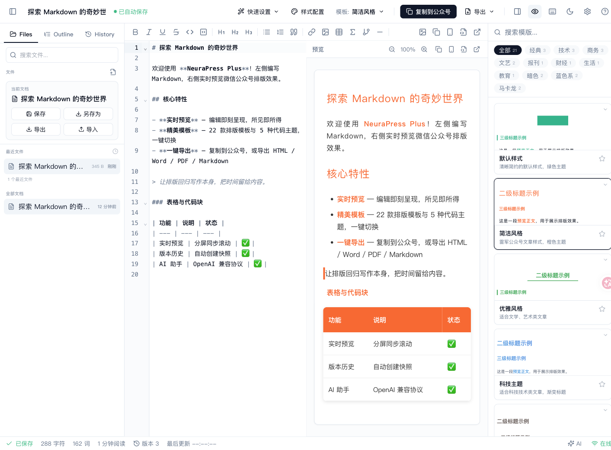

# NeuraPress Plus

面向微信公众号作者的 Markdown 排版编辑器：左侧写 Markdown，右侧实时预览，一键复制带排版的内容到公众号。



本项目是开源版 NeuraPress 的**本地重构版**：以 [NeuraPress Pro](https://md.newkit.site/) 的交互为参照，重写了编辑器内核（CodeMirror 6）、数据层、模板系统与整个编辑器外壳。全部功能在浏览器本地运行，**没有后端服务、没有数据库、不需要登录**。

## ✨ 功能

### 编辑器
- **CodeMirror 6**：行号、Markdown 语法高亮、代码折叠、搜索替换（`Ctrl+F`）、自动补全、明暗主题
- **格式化工具栏**：粗体 / 斜体 / 下划线 / 删除线 / 行内代码 / 代码块、标题（工具栏 1–3，快捷键支持 1–6）、列表、引用、链接、图片、表格、数学公式、Mermaid 图表、分割线
- **实时预览**：分屏同步滚动、缩放（50%–150%）、手机预览、HTML 源码查看、新标签页打开
- **快捷键**：文件、编辑、格式三组，点顶栏键盘图标或按 `Ctrl+/` 查看完整列表

### 文档管理
- 多文档 + 自动保存，最近文件带打开时间与大小
- 侧边栏 **Files / Outline / History** 三个标签页：
  - Files：文件搜索、当前文档卡片（保存 / 另存为 / 导出 / 导入）、最近文件、全部文档
  - Outline：标题大纲 + 行号，点击跳转到编辑器对应行
  - History：自动版本快照，一键恢复
- 导入：本地 `.md` 文件、Notion 导出文件（zip / md）

### 模板与样式
- **22 款模板 / 11 个分类**：搜索、收藏、卡片实时预览
- **样式配置**：30 色主题色板 + 自定义 HEX、字号、行高、文本对齐、5 种代码主题
- 表格、代码块、公式、链接等均生成微信可用的**内联样式**；表格表头跟随模板主题色

### 导出与图片
- **复制到公众号**（带排版，可把外链转成底部引用）
- 导出 **HTML / Word / PDF（打印） / Markdown**
- **图片管理弹窗**：拖拽或点击上传、图片链接、图片库（上传历史）、图床设置；未配置图床时以 base64 内嵌

### 其它
- AI 助手：OpenAI 兼容协议，API Key 仅存本地，提供润色 / 翻译等快捷指令
- 状态栏：字符 / 词数 / 阅读时长 / 版本数 / 最后更新 / 在线状态
- 明暗主题、落地页、帮助页、关于页；`/xiaohongshu` 小红书笔记编辑器

> **说明**：AI 助手需自行配置兼容 OpenAI 的接口；「多平台发布」为平台入口提示，未接入 Pro 站的私有浏览器扩展；`/xiaohongshu` 保留原有 tiptap 实现，与 `/wechat` 的 CodeMirror 编辑器是两套代码。

## 🚀 快速开始

### 环境要求
- Node.js 18.17+（推荐 20）
- pnpm 8+

### 本地开发

```bash
git clone https://github.com/anydu/neurapress-plus.git
cd neurapress-plus
pnpm install
pnpm dev
```

打开 <http://localhost:3000/wechat> 进入编辑器；<http://localhost:3000/> 为落地页。

### 构建与运行

```bash
pnpm build      # 生产构建
pnpm start      # 启动生产服务器
```

## 🐳 Docker

`docker/` 目录提供两套配置：

```bash
# 开发环境：Dockerfile.dev + 源码挂载 + pnpm dev（支持热重载）
docker compose -f docker/docker-compose.yml up -d

# 生产环境：多阶段构建 + pnpm start
docker build -t neurapress:prod -f docker/Dockerfile.prod .
docker run -p 3000:3000 neurapress:prod
```

> - 生产构建的上下文是**项目根目录**，而仓库目前只有 `docker/.dockerignore`（不会被 Docker 读取）。建议在项目根添加 `.dockerignore` 后再构建，避免把 `node_modules`、`.next` 打进上下文；`Dockerfile.prod` 使用 BuildKit 缓存挂载，需 `DOCKER_BUILDKIT=1`。
> - 应用没有服务端 API：部署到 NAS 或静态托管只是托管页面，**文档数据保存在访问者浏览器的 localStorage**，换设备不共享、清缓存会丢失。重要内容请用「导出 Markdown / HTML」备份。

## 📁 目录结构

```
src/app/                        页面：/、/wechat、/xiaohongshu、/help、/about
src/components/editor/
  ProEditor.tsx                 编辑器外壳、全局快捷键、弹窗编排
  components/                   顶栏、工具栏、侧边栏、预览、状态栏、模板面板、AI 面板
  components/dialogs/           样式配置、编辑器设置、图片管理、版本历史、发布、Notion 导入、快捷键
  hooks/                        预览转换、复制、AI 等
  store/EditorStore.tsx         文档 / UI 状态（Context + reducer）
src/lib/
  markdown/                     Markdown → 微信内联样式 HTML（marked / KaTeX / Mermaid）
  editor/formatCommands.ts      CodeMirror 格式化命令与快捷键
  storage/                      文档、最近文件、版本历史、图床、图片库持久化
  export/                       HTML / Word / Markdown / 打印 PDF
  ai/                           OpenAI 兼容服务
src/templates/                  22 款模板注册表与分类
src/config/                     代码主题、兼容 shim
src/styles/                     编辑器样式
public/assets/img/              产品截图等静态资源
docker/                         开发与生产 Docker 配置
```

## ⌨️ 常用快捷键

macOS 下 `Ctrl` 对应 `⌘ Command`。

| 分类 | 快捷键 | 功能 |
| --- | --- | --- |
| 文件 | `Ctrl+S` / `Ctrl+Shift+S` | 保存 / 另存为 |
| 文件 | `Ctrl+N` / `Ctrl+O` / `Ctrl+E` | 新建 / 导入 / 导出 HTML |
| 文件 | `Ctrl+Shift+P` / `Ctrl+/` | 显示隐藏预览 / 快捷键面板 |
| 编辑 | `Ctrl+F` / `Ctrl+Z` | 搜索替换 / 撤销 |
| 格式 | `Ctrl+B` / `Ctrl+I` / `Ctrl+U` | 粗体 / 斜体 / 下划线 |
| 格式 | `Ctrl+1` ~ `Ctrl+6` | 一至六级标题 |
| 格式 | `Ctrl+K` / `Ctrl+Shift+T` / `Ctrl+Shift+I` | 链接 / 表格 / 图片管理 |
| 格式 | `Ctrl+Shift+C` / `Ctrl+Shift+M` | 代码块 / 数学公式块 |

## 💾 本地数据

所有数据存在浏览器 `localStorage`，主要键名：

| 键 | 内容 |
| --- | --- |
| `markdown-editor-documents` | 多文档（内容、模板、样式配置、代码主题） |
| `markdown-editor-recent-files` / `-version-history` | 最近文件 / 版本快照 |
| `markdown-editor-ui` / `markdown-editor-settings` | 界面状态 / 编辑器设置 |
| `image_host_configs` / `image_history` | 图床配置 / 图片库历史 |

换浏览器或清理站点数据会丢失这些内容，请定期导出备份。

## 🛠 技术栈

- **框架**：Next.js 14（App Router）、React 18、TypeScript 5
- **UI**：Tailwind CSS 3、Radix UI（本地封装组件）、lucide-react、next-themes
- **编辑器**：CodeMirror 6（`@codemirror/*`）
- **渲染**：marked 16、KaTeX、Mermaid 11、Prism 代码高亮
- **其它**：JSZip（Notion 导入）、clipboard-polyfill、pnpm

## 致谢与许可

本项目基于 [tianyaxiang/neurapress](https://github.com/tianyaxiang/neurapress) 开源版重构，编辑器交互参照 [NeuraPress Pro](https://md.newkit.site/)。

基于 [MIT License](LICENSE) 开源。问题与建议请提交到本仓库的 Issues。
